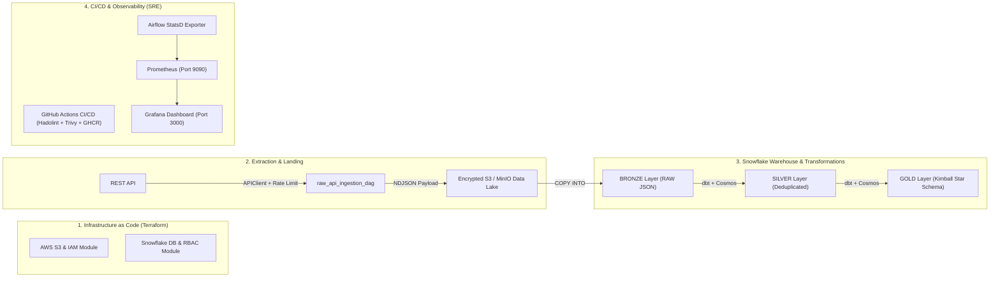

# Enterprise Modern Data Stack (MDS) Pipeline

[](https://github.com/enterprise/mds-pipeline/actions/workflows/ci.yml)
[](https://github.com/enterprise/mds-pipeline/actions/workflows/cd.yml)
[](https://getdbt.com)
[](https://airflow.apache.org)
[](https://www.terraform.io)
[](https://grafana.com)

An enterprise-grade, end-to-end data platform implementing the **Modern Data Stack architecture** with production-grade **DevOps, DevSecOps, SRE, and Infrastructure as Code (IaC)**.

This platform ingests raw REST API payloads, stages records into an encrypted **AWS S3 / MinIO** data lake, loads data into **Snowflake Data Warehouse**, transforms raw variant JSON into Medallion architecture layers (**Bronze, Silver, Gold Kimball Star Schema**) via **dbt**, and orchestrates workflows using **Apache Airflow & Astronomer Cosmos** with real-time operational telemetry.

---

## 🏗 Architecture & DevOps Data Flow



---

## 📁 Repository Directory Structure

```text
enterprise-mds-pipeline/
├── .github/
│   └── workflows/
│       ├── ci.yml                 # CI: Ruff, Pytest, SQLFluff, Hadolint, Docker build & Trivy scan
│       └── cd.yml                 # CD: dbt manifest validation & GHCR image publishing on merge
│
├── dags/
│   ├── __init__.py
│   ├── raw_api_ingestion_dag.py   # Airflow DAG: API extract -> S3/MinIO -> Snowflake Raw
│   ├── dbt_cosmos_transform_dag.py# Airflow DAG: Executes dbt Silver & Gold models via Cosmos
│   └── utils/
│       ├── __init__.py
│       ├── api_client.py          # Custom API extraction logic with rate limiting
│       ├── snowflake_hooks.py     # Snowflake connection & stage loader utilities
│       └── alert_callbacks.py     # Discord/Slack webhook failure alert functions
│
├── dbt_project/
│   ├── dbt_project.yml            # Main dbt configuration file
│   ├── packages.yml               # dbt external dependencies (e.g., dbt-utils, dbt-expectations)
│   ├── profiles.yml               # Warehouse connection profile (Snowflake / DuckDB)
│   ├── models/                    # Bronze, Silver, Gold Kimball models
│   └── tests/                     # Custom SQL integrity tests
│
├── terraform/                     # Declarative Infrastructure as Code (IaC)
│   ├── aws/                       # AWS S3 Data Lake (AES256, versioning, Glacier lifecycle) & IAM roles
│   │   ├── main.tf
│   │   ├── variables.tf
│   │   └── outputs.tf
│   └── snowflake/                 # Snowflake Warehouses, DBs, Schemas & RBAC
│       ├── main.tf
│       ├── variables.tf
│       └── outputs.tf
│
├── monitoring/                    # Observability & Site Reliability Engineering (SRE)
│   ├── statsd-exporter/           # StatsD mapping configuration for Airflow metrics
│   │   └── statsd.mapping.yml
│   ├── prometheus/                # Scrape targets and metric retention configs
│   │   └── prometheus.yml
│   └── grafana/                   # Automated datasource and dashboard provisioning
│       ├── provisioning/
│       └── dashboards/airflow_overview.json
│
├── tests/                         # Unit tests for custom ingestion scripts and DAG integrity
│   ├── test_api_client.py
│   └── test_dag_integrity.py
│
├── .env.example                   # Environment variable template (keys, DB creds)
├── .pre-commit-config.yaml        # Local Git hook validation (ruff, black, check-yaml)
├── .sqlfluff                      # SQLFluff config for dbt SQL linting
├── Dockerfile                     # OCI-compliant Airflow image with dbt & Python dependencies
├── docker-compose.yml             # Orchestration stack: Airflow, Postgres, MinIO, Prometheus, Grafana
├── Makefile                       # Developer & DevOps CLI targets
├── pyproject.toml                 # Linter configuration (Ruff)
└── requirements.txt               # astronomer-cosmos, dbt-snowflake, boto3, etc.
```

---

## ⚡ Quickstart & Setup Guide

### 1. Prerequisites
- **Docker & Docker Compose** (version 20.10+ / Compose v2)
- **Python 3.10+**
- (Optional) **AWS CLI** and **Terraform 1.5+** for cloud provisioning

### 2. Environment Configuration
Copy the `.env.example` template to `.env`:
```bash
cp .env.example .env
```

### 3. Launch Local Pipeline & Observability Infrastructure
Start PostgreSQL, Airflow Webserver, Airflow Scheduler, MinIO, StatsD Exporter, Prometheus, and Grafana:
```bash
make up
```

Access services locally:
- **Airflow UI**: [http://localhost:8080](http://localhost:8080) (`admin` / `admin`)
- **MinIO Console**: [http://localhost:9001](http://localhost:9001) (`minioadmin` / `minioadmin`)
- **Prometheus UI**: [http://localhost:9090](http://localhost:9090)
- **Grafana SRE Dashboard**: [http://localhost:3000](http://localhost:3000) (`admin` / `admin`)

---

## 🧪 Testing, Linting & Code Quality

Run tests and linters locally with the provided Makefile:

```bash
# Run Python unit tests and Airflow DAG integrity checks
make test

# Run code style & formatting checks (Ruff + SQLFluff)
make lint

# Run dbt transformations & data quality tests (DuckDB dev engine)
make dbt-deps
make dbt-run
make dbt-test
```

---

## 🚀 CI/CD & DevSecOps Pipeline

The repository includes enterprise-grade GitHub Actions workflows:

1. **Continuous Integration (`.github/workflows/ci.yml`)**:
   - **Static Code Analysis**: Checks code formatting and bugs with `ruff`.
   - **DAG Validation & Unit Testing**: Runs DAG integrity and API client unit tests via `pytest`.
   - **SQL Model Quality**: Lints dbt models against `sqlfluff`.
   - **IaC Formatting**: Enforces `terraform fmt` across all Terraform modules.
   - **Container Security & Linting (DevSecOps)**:
     - Lints `Dockerfile` with **Hadolint**.
     - Builds Docker container image with layer caching.
     - Scans image for High/Critical CVEs using **Aqua Security Trivy**.

2. **Continuous Deployment (`.github/workflows/cd.yml`)**:
   - Triggers on merge to `main`.
   - Parses and validates dbt production manifest artifacts.
   - Builds and publishes the release image to **GitHub Container Registry (`ghcr.io`)** tagged with `latest` and commit SHA.

---

## 🌐 Infrastructure as Code (Terraform)

Infrastructure is codified declaratively under `terraform/`:

- **AWS Module (`terraform/aws/`)**:
  - Encrypted, versioned S3 bucket for raw data-lake ingestion.
  - S3 lifecycle rule auto-transitioning raw JSON payloads to **AWS Glacier** after 90 days.
  - Public access block preventing accidental exposure.
  - Least-privilege IAM policies and roles for Airflow worker instances.
- **Snowflake Module (`terraform/snowflake/`)**:
  - Declarative compute warehouse (`COMPUTE_WH`) with auto-suspend and auto-resume.
  - Medallion databases and schemas (`RAW`, `STAGING`, `ANALYTICS`).
  - RBAC roles (`DATA_ENGINEER`) with scoped permissions.

---

## 📄 License
Distributed under the MIT License.
